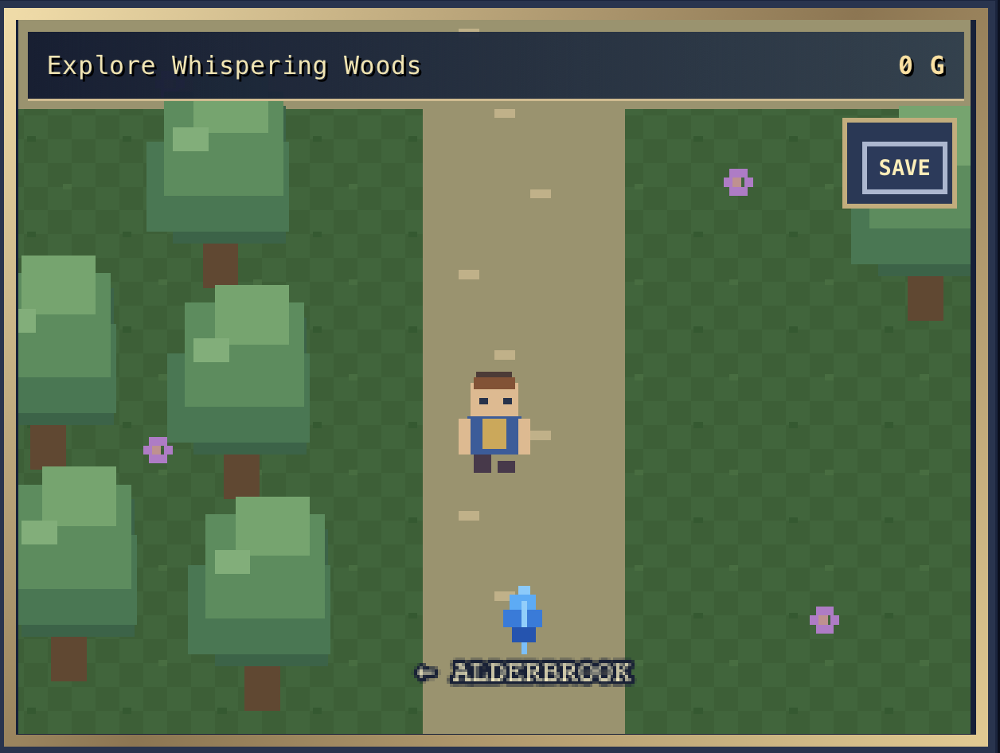

# ✦ Echoes of the Crystal ✦

### An original, retro-inspired fantasy RPG built with Phaser 3

**Explore • Discover • Battle • Grow**

*Actual gameplay screenshot — Whispering Woods (V9.1)*

## About the game

**Echoes of the Crystal** is an in-development, browser-based 2D role-playing game inspired by the atmosphere and adventure of classic 16-bit JRPGs. Begin your journey in **Alderbrook Village**, speak with its residents, investigate a mysterious crystal, and venture into the **Whispering Woods**.

The project combines pixel-art-inspired visuals, exploration, story-driven quests, and turn-based battles. It is an original indie game project, developed and expanded one milestone at a time.

## Current gameplay

- **Explore two areas:** Alderbrook Village and Whispering Woods.
- **Follow quests:** meet the Elder, investigate the village crystal, and unlock the forest.
- **Fight turn-based battles:** encounter enemies, earn experience, and collect gold.
- **Progress your character:** gain levels and improve your stats.
- **Manage resources:** use your inventory, potions, and the village shop.
- **Save your progress:** continue your adventure using browser-based local saves.
- **Play on mobile:** on-screen directional controls and a TALK / NEXT button support landscape play.

> **Development status:** Playable prototype — V9.1. Features and balance are still being tested and improved.

## How to play

1. Open the game in a browser through your running project or local development server.
2. Select **NEW GAME** (or **BAG** on the title screen to continue a saved game).
3. Use the on-screen **D-pad** to move and **TALK / NEXT** to interact or advance dialogue.
4. Follow the objective displayed at the top of the game screen.
5. Use **SAVE** to store progress on your current device/browser.

**Note:** Saves use browser local storage. They are not cloud-synced and may be lost if browser site data is cleared.

## Built with

- **JavaScript** — game logic and interactions
- **Phaser 3** — 2D game engine
- **HTML & CSS** — page layout and mobile controls
- **Replit** — development and browser testing
- **Git & GitHub** — version control and project history

The project is being organized into separate source files to make future gameplay systems easier to maintain and extend.

## Development roadmap

- [x] Build the initial village and character movement
- [x] Add dialogue, quests, and crystal interactions
- [x] Implement turn-based combat and enemy encounters
- [x] Add inventory, shop, potions, leveling, and saving
- [x] Open the path to Whispering Woods
- [ ] Expand forest exploration and story content
- [ ] Refine combat balance and game UI
- [ ] Add more locations, enemies, and quests
- [ ] Improve accessibility, mobile usability, and testing

*The roadmap is subject to change as development progresses.*

## Project links

**Source code:** [github.com/codeguyty/echoes-of-the-crystal](https://github.com/codeguyty/echoes-of-the-crystal)

## Creator

Created by **CodeGuyTy** as a hands-on game development and software engineering project.

---

*An adventure is taking shape, one crystal echo at a time.*

